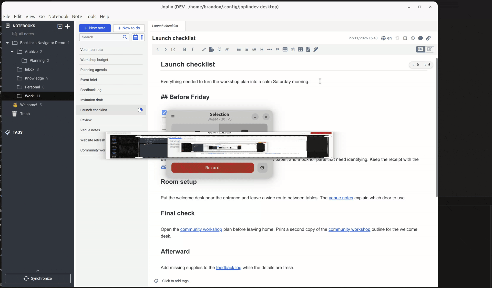

> [!note]
> This plugin was created entirely with AI tools.

> [!important]
> This plugin only works in the markdown editor (editor view or split view). It does not work in the reading view or in the rich text editor. Codemirror 6 only, legacy editor is not supported.

# Backlinks Navigator

A Joplin plugin for viewing and navigating backlinks and outgoing links in the Markdown editor.



## Features

- Shows notes that link to the current note
- Shows notes linked from the current note
- (Backlinks) Shows each link occurrence when a note links more than once, grouped under that note, and scrolls to the occurrence on navigation
- (Outgoing links) Links pointing to a specific anchor - a heading, or an explicit HTML anchor such as `<a id="in3b65">` - show as their own entry grouped under the linked note, and scroll to that anchor on navigation
- Switch between compact and detailed views from the panel; the choice is remembered
- Supports reference style note links
- Opens related notes from a compact floating panel in the markdown editor
- Filters links by note title
- Shows notebook, section, and link context when available
- Optionally shows a linked-note count indicator in the editor (which can also be used to open the panel)
- Works on desktop and mobile
    - Note: Scrolling to specific link locations on note switch has limitations on mobile (only works for outgoing links, no highlight effect).

## Usage

Open the links panel from the note toolbar button (editor toolbar on mobile), editor indicator icon (if enabled in settings), the Edit menu, or the `Show Links` command. On desktop, the toolbar button is grayed out when the markdown editor isn't visible (Rich Text editor or viewer-only layout).

> [!note]
> There isn't a default keyboard shortcut, you can assign one under Tools | Options | Keyboard Shortcuts | "Show Links" command.

Click a backlink to open the note that links to the current note, or click an outgoing link to open the note linked from the current note.

When a note links to the current note more than once, its backlinks are grouped under one entry for that note, showing how many links it has. Click an individual backlink to scroll to that specific link after switching notes, or click the note's entry to just open the note. Outgoing links to several headings or anchors in the same note are grouped the same way, with the note's own snippet on its entry.

Use the show/hide details button at the end of the tab bar to switch between a compact one-line-per-note list (hiding individual links and context previews) and the expanded view with nested links and snippets. The choice is remembered. The counts on the tabs and the editor indicator are the number of linked notes, so they stay the same either way.

Any outgoing links referencing an anchor (pointing to a markdown heading or html anchor) will scroll to that heading or anchor on note switch.

## Settings

- Panel width
- Panel max height
- Show link indicator - recommend using with a max editor width set in joplin settings | editor tab to avoid overlapping content
- Ignored note IDs - comma-separated note IDs to exclude from link results and counts
- Ignored notebook IDs - comma-separated notebook IDs to exclude from link results and counts, including their sub-notebooks. Right-click a notebook and choose `Toggle Backlinks Navigator ignore` to add or remove it.
- Ctrl-click link behavior - open in a new window or in a Note Tabs tab (requires the Note Tabs plugin)
- Ctrl-Enter link behavior - open the selected link in a new window or in a Note Tabs tab (requires the Note Tabs plugin)
- Middle click link behavior - open the selected link in a new window or in a Note Tabs tab (requires the Note Tabs plugin)
- Show nearest heading for backlinks - display the nearest heading above each backlink when panel details are expanded
- Enable debug logging

## Limitations

- Scrolling to a specific backlink occurrence after note switch only works on desktop. It does not work when opening the note in a new window or pinning with Note Tabs.

## Building

Requires Node 22 or later.

```sh
npm ci
npm run dist
```

The installable plugin is written to `publish/com.bwat47.joplin-backlinks-navigator.jpl`.
